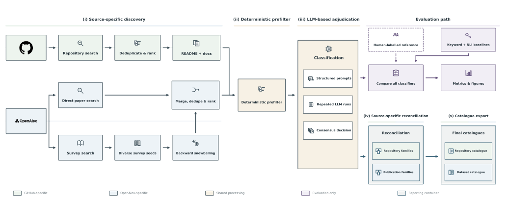

# RADAR


**Reproducible Acquisition, Discovery, Assessment, and Reporting**

An auditable research framework for discovering repositories and scholarly papers, assessing their evidence against explicit study protocols, and evaluating results against external references.


[](https://github.com/maldwg/RADAR/actions/workflows/documentation.yml)


[Source](https://github.com/maldwg/RADAR) · [Documentation · IDS-RADAR](https://ids-radar.readthedocs.io/en/latest/) · [Quick start](docs/quickstart.rst) · [Architecture](docs/architecture.rst) · [Reproducibility](docs/reproducibility.rst)

## Research workflows

RADAR separates provider access, shared acquisition services, scientific protocols, and reporting. Studies own their search vocabulary, eligibility criteria, taxonomy, prompts, and evaluation references; shared infrastructure handles retrieval, evidence acquisition, repeated assessments, and audit artifacts.

| Study | Discovery | Scientific output |
| --- | --- | --- |
| `ids_repositories` | GitHub | Role-labelled repository classifications and canonical project families |
| `ids_datasets` | OpenAlex | Dataset and generator release classifications and publication families |
| `conformal_treatment_effects` | OpenAlex by default; optional Semantic Scholar and local files | Evidence-backed eligibility, quality judgments, and assumption extraction |

The two paper studies share collection, evidence acquisition, prefiltering, and operational configuration keys. Reviews can combine several providers into one deduplicated cohort. Catalogue workflows currently retain their specialized GitHub and OpenAlex integrations; implementing discovery alone does not enable a new catalogue provider.

## Architecture



- **Explicit study protocols:** TOML profiles define acquisition budgets, evidence policies, scientific criteria, prompts, and consensus settings.
- **Shared provider contracts:** adapters normalize native records and expose supported lookup, evidence, and reference capabilities.
- **Auditable assessment:** literal evidence checks, repeated model assessments, and ensembles retain their supporting decisions and quotes.
- **Comparable evaluation:** keyword, NLI, and structured LLM approaches are evaluated against declared reference sets with explicit denominators and abstention handling.
- **Verifiable reports:** SVG/PDF figures, companion tables, input snapshots, and manifests support integrity checks and declared numerical replay.

[Pipeline: SVG](pipeline_architecture.svg) / [PDF](pipeline_architecture.pdf) · [System: SVG](system_architecture.svg) / [PDF](system_architecture.pdf)

[Complete UML: SVG](docs/_static/models/uml-all-classes.svg) · [Focused class diagrams](docs/class_diagrams.rst) · [Reporting ER: SVG](docs/_static/models/er-reporting.svg) · [Cache ER: SVG](docs/_static/models/er-cache.svg)

Class diagrams and database models are generated directly from the Python and SQL sources. Regenerate with `python scripts/generate_design_models.py`; CI checks them with `--check`. See the [database guide](docs/database_model.rst) for key semantics and [class inventory](docs/class_inventory.rst) for every class.

## Quick start

Use Python 3.11 or newer and run commands from the repository root. The checked-in catalogue baselines require the `nli` extra; the conformal review can use the core installation.

```bash
git clone https://github.com/maldwg/RADAR.git
cd RADAR
python -m venv .venv
. .venv/bin/activate
python -m pip install -e '.[nli]'
radar --help
```

Set the Ollama endpoint for your deployment and provide the credentials needed by your selected providers:

```bash
export OLLAMA_URL=http://127.0.0.1:11434
export GITHUB_TOKEN=your-token
export OPENALEX_MAILTO=researcher@example.org
# Optional provider keys:
# export OPENALEX_API_KEY=your-key
# export SEMANTIC_SCHOLAR_API_KEY=your-key
```

Configure available models in `config/shared/models.toml`. The checked-in profile selects `gemma4:31b` and `qwen3.8:27b`; install those models on your Ollama service or update the profile and explicit study ensemble membership. Hardware and context capacity depend on the chosen models.

Validate configurations without retrieval or inference, then execute the studies:

```bash
radar --study ids_repositories validate
radar --study ids_datasets validate
radar --study conformal_treatment_effects validate

radar --study ids_repositories run
radar --study ids_datasets run
radar --study conformal_treatment_effects run
```

Each study writes to `artifacts/studies/<study>/`. Start a new experiment with a clean output root. The defaults retain at most 100 candidates and classify every eligible retained row; `classification_limit = "all"` still respects the prefilter. Adjust collection and classification budgets independently:

```bash
radar --study ids_datasets run --collect-limit 1000 --classify-all
```

See the [installation guide](docs/quickstart.rst), [pipeline methods](docs/pipeline.rst), and [multi-provider configuration](docs/adapters.rst) for stage commands and extension points. The Python module entry point is `python -m radar`.

## Configuration and outputs

```text
config/
├── shared/                       # Runtime, models, and provider transport
└── studies/
    ├── ids_repositories/
    ├── ids_datasets/
    └── conformal_treatment_effects/
        ├── study.toml            # Workflow, profiles, providers, output root
        ├── pipeline.toml         # Collection, evidence, voting, reconciliation
        ├── screening.toml        # Scientific eligibility and quality rules
        ├── taxonomy.toml         # Labels and extraction fields
        ├── search/               # Provider-native queries
        ├── prompts/              # Evidence assessment instructions
        └── evaluation/           # Reference labels used only for evaluation
```

Catalogue studies additionally own their baseline profiles. Candidate audits, per-model classifications, ensembles, processed catalogues, evaluation tables, figures, and run manifests remain scoped to their study. Reviews retain the union cohort and provider memberships. See [configuration](docs/configuration.rst) and [reporting](docs/reporting.rst) for exact layouts.

## Reproducibility and evaluation

Record the repository revision, environment, study profiles, provider coverage, Ollama version, and model identity with every experiment. Retain the candidate evidence and assessment audits alongside each report's manifests and `.provenance/objects/` directory.

```bash
radar --study ids_datasets evaluate
radar verify --input artifacts/studies/ids_datasets/evaluation/openalex
radar architecture
```

Verification distinguishes numerical **recomputation** from **integrity-only** checks. Reference labels enter evaluation only. Catalogues are bounded by source indexing, query coverage, budgets, and available evidence. The eleven-paper conformal benchmark contains positives only and cannot estimate false-positive performance; the dataset benchmark's selected negative controls do not represent all excluded literature. Repeated model votes are not independent statistical confidence estimates.

The [reproducibility guide](docs/reproducibility.rst), [evaluation specification](docs/evaluation.rst), and [conformal verification guide](docs/cross_field_verification.rst) explain the evidence needed to support research claims. The maintained [research notes](docs/research_notes.rst) record encountered caveats and design decisions.

## Development and documentation

The tests use offline API and model fixtures:

```bash
MPLCONFIGDIR=/tmp/radar-mpl PYTHONPATH=src \
  python -m unittest discover -s tests -v
```

Detailed documentation uses native reStructuredText, Sphinx, and the Read the Docs theme. Build it with warnings treated as errors:

```bash
python -m pip install -r docs/requirements.txt
python -m sphinx -n -W --keep-going -b html docs docs/_build/html
python -m http.server --directory docs/_build/html 8000
```

Open `http://localhost:8000`. The [documentation workflow](.github/workflows/documentation.yml) runs the strict build on pushes, pull requests, and manual dispatch, and saves downloadable HTML previews. Connect the repository to Read the Docs once to enable automatic hosted builds and pull request previews through its GitHub integration; no separate deployment token or upload job is required. See [development and hosted setup](docs/development.rst) for instructions and the [provider contract reference](docs/api.rst) for interfaces.
