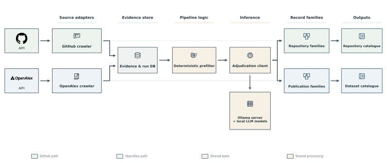

RADAR architecture
==================

RADAR stands for **Reproducible Acquisition, Discovery, Assessment, and
Reporting**. Providers retrieve and normalize records; shared services collect
and acquire evidence; study protocols define scientific decisions; reporting
and verification retain the inputs and denominators behind those decisions.

Pipeline view
-------------

.. figure:: ../pipeline_architecture.svg
   :alt: RADAR pipeline with study configurations, provider discovery, shared paper evidence, scientific screening, consensus, outputs, and evaluation-only references.
   :width: 100%

   Five stages for a selected study. IDS datasets and conformal treatment effects
   reuse paper collection, evidence acquisition, and operational configuration
   keys while applying different scientific rules.

:download:`Pipeline SVG <../pipeline_architecture.svg>` ·
:download:`Pipeline PDF <../pipeline_architecture.pdf>`

Component view
--------------

   Provider access, collection, evidence, inference, and audited outputs.
   State and assessments remain scoped to their study and model.

:download:`System SVG <../system_architecture.svg>` ·
:download:`System PDF <../system_architecture.pdf>`

Interfaces and workflow boundaries
----------------------------------

All discovery providers satisfy the ``DiscoveryAdapter`` protocol and normalize
records into ``SourceRecord``. Lookup, evidence enrichment, and reference
traversal are optional capabilities. ``JsonTransport`` shares HTTP mechanics;
study criteria and taxonomy do not belong in the transport or discovery layer.
See :doc:`adapters` and :doc:`api` for the current contracts.

Systematic reviews can combine OpenAlex, Semantic Scholar, and local-file
discovery. Their shared runner retains provider memberships and deduplicates
records using strong identifiers. Repository and dataset catalogue workflows
currently retain specialized collection, baseline, and reconciliation
integrations. A discovery adapter alone does not enable a catalogue workflow.

Reference labels enter evaluation only. They are excluded from retrieval and
assessment prompts. Figure manifests record renderer and asset snapshots;
architecture diagrams have integrity verification rather than numerical replay.

Implementation models
---------------------

See :doc:`class_diagrams` for the UML class views and complete class inventory,
and :doc:`database_model` for the reporting and pipeline-cache ER models.
These describe implementation relationships; the figures above describe
execution flow and component responsibilities.

Regenerate figures
------------------

.. code-block:: bash

   radar architecture
   radar architecture --output artifacts/architecture
   python -m radar.architecture --formats svg,pdf
